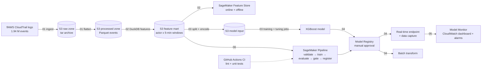

# AWS CloudTrail Suspicious-Activity Classifier

**AAI-540 Machine Learning Operations · Group 3** — Jagdish Mane · Harshil Shah · Farhath Bhat

An end-to-end MLOps system on **Amazon SageMaker** that scores AWS CloudTrail activity as *normal* or
*suspicious*. It is built so a security team can review the riskiest activity first instead of reading
millions of API-call logs.

* **Unit of prediction:** one actor's activity in one **5-minute window**.
* **Model:** one binary **XGBoost** classifier (SageMaker built-in algorithm).
* **Output:** a risk score from 0 to 1, mapped to `LOW` / `MEDIUM` / `HIGH`. The thresholds are set from
  analyst capacity: 5 alerts/day for MEDIUM and 1/day for HIGH.
* **Labels:** rule-based *weak labels*. A window counts as suspicious if it contains, or is followed within
  30 minutes by, audit-trail tampering, public data exposure, a credential or privilege change, or a console
  login without MFA.

## Architecture



## Repository layout

```
├── notebooks/                       run in order in SageMaker Studio
│   ├── 01_data_ingestion_eda.ipynb              raw data → S3, Parquet, exploratory analysis
│   ├── 02_feature_engineering_feature_store.ipynb  feature mart (DuckDB) → S3 + Feature Store
│   ├── 03_train_tune_evaluate.ipynb             SageMaker training + tuning jobs, evaluation
│   ├── 04_registry_deployment_inference.ipynb   Model Registry, real-time endpoint, batch transform
│   ├── 05_monitoring.ipynb                      CloudWatch, Model Monitor, drift report, cleanup
│   └── 06_cicd_pipeline.ipynb                   SageMaker Pipeline (success + failed runs)
├── src/cloudtrail_mlops/            shared code imported by notebooks, pipeline steps and tests
│   ├── config.py        constants: S3 layout, split dates, feature contract, hyper-parameters, gate
│   ├── ingest.py        download, checksum, safe extraction, JSON → Parquet
│   ├── features.py      leakage-free feature engineering in DuckDB SQL + data-quality checks
│   ├── dataset.py       chronological split, one-hot encoder, XGBoost CSV export
│   ├── evaluation.py    metrics, alert-budget thresholds, quality gate, PSI drift
│   ├── model.py         load / score the SageMaker XGBoost artefact
│   ├── aws.py           SageMaker session + project state helpers
│   └── plots.py         chart styling
├── pipelines/
│   ├── pipeline.py                  SageMaker Pipeline definition (CD)
│   ├── steps/preprocess.py          pipeline step: validate + split + encode
│   ├── steps/evaluate.py            pipeline step: thresholds + test metrics → evaluation.json
│   └── best_hyperparameters.json    written by notebook 03
├── tests/                           pytest unit tests on synthetic CloudTrail data
├── docs/data_catalog.md             what is stored where in S3
├── experiments/event_level_baseline/  earlier event-level workflow (baseline that motivated the window design)
└── .github/workflows/ci.yml         CI: ruff + pytest on every push / PR
```

## Data

All data lives in **Amazon S3** under `s3://<sagemaker-default-bucket>/cloudtrail-mlops/`. Nothing is
stored in git. See [`docs/data_catalog.md`](docs/data_catalog.md) for every location and format.

## How to run (SageMaker Studio, AWS Academy Learner Lab)

1. Start the Learner Lab, open the AWS console and go to **SageMaker AI → Studio**. Open **JupyterLab**,
   using `ml.t3.medium` (switch to `ml.m5.large` for notebook 02).
2. Clone the repository from a terminal:
   `git clone https://github.com/JagdishMane/AWS_CloudTrail_Suspicious_Activity_Classifier.git`
3. Run the notebooks **in order, 01 → 06**. The first cell of each notebook installs `requirements.txt`.
   Each notebook reads what the previous one stored in S3, so teammates can run different notebooks.
4. **Cost control:** the endpoint is the only resource that bills by the hour. Notebook 05 ends with a
   cleanup cell; set `CLEANUP = True` once the demo is recorded. Also stop the JupyterLab space when you
   are done.

Run the tests locally:
```bash
pip install -r requirements-dev.txt
pytest -v tests && ruff check src pipelines tests
```

## Key design decisions

| decision | why |
|---|---|
| Actor × 5-minute windows instead of single events | single API calls are ambiguous; bursts of behaviour compared with the actor's own history are informative |
| Strictly-prior history features, policy columns excluded | prevents target leakage (verified by unit tests) |
| Chronological split: train 2017–18, validation 2019, test 2020 | the model must work on *future* activity; a random split overstates performance |
| Average precision, ROC-AUC and recall at an alert budget instead of accuracy | positives are < 1 % of windows |
| Thresholds from analyst capacity | an alert queue has a fixed daily review budget |
| Release gate: test ROC-AUC ≥ 0.80 and AP lift ≥ 5× | only models that clearly beat random ranking are registered |

## Baseline experiment

`experiments/event_level_baseline/` holds an earlier end-to-end workflow that scored individual events. Its weak label
is a deterministic function of its own input features (root identity, sensitive API names, authorisation failures),
so it reaches ROC-AUC ≈ 1.0 by reproducing the rule. That finding motivated the final design: actor × 5-minute windows,
label-defining columns excluded from the inputs, and evaluation on an untouched future year
(see that folder's README).

## Limitations

* Labels are rule-derived proxies, not analyst-confirmed incidents.
* Positives are rare and concentrated in a few actors, so metrics have wide uncertainty.
* The dataset comes from a public security-training environment.

See the design document for the security, privacy and ethics review and for future enhancements.

## Team

| Member | Ownership |
|---|---|
| Jagdish Mane | data ingestion & EDA (01), feature engineering & Feature Store (02) |
| Harshil Shah | training, tuning & evaluation (03), registry & deployment (04) |
| Farhath Bhat | monitoring (05), CI/CD pipeline (06), integration & repository |
