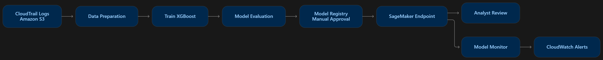

# AWS CloudTrail Suspicious Activity Classifier

This project uses machine learning to predict the suspicious AWS API activity in CloudTrail logs. The project workflow prepares historical events, generates rule-based weak labels, trains XGBoost in a notebook kernel, evaluates the model, and  deploys it to an Amazon SageMaker real-time endpoint. Additioanl test the endpoint and setup alerts.


## Architecture



```text
CloudTrail archive → Amazon S3 → Data preparation
                                      ↓
                         Data split - train/validation/test
                                      ↓
                               XGBoost training
                                      ↓
                         Evaluation and validation quality gate
                                      ↓
                         Manual approval → SageMaker Registry
                                      ↓
                                SageMaker endpoint
                                      ↓
                                Endpoint Test
                            Setup monitoring and alarms

```

**Note**: The model is traied within Jupterlab instance.

## Repository guide

| Path | Purpose |
| --- | --- |
| [`CloudTrail_SageMaker_MLOps.ipynb`](CloudTrail_SageMaker_MLOps.ipynb) | Main event-level preparation, training, evaluation, deployment, monitoring, and cleanup workflow. |
| [`teamwork/01_CloudTrail_EDA_Group3.ipynb`](teamwork/01_CloudTrail_EDA_Group3.ipynb) | Dataset exploration, provenance checks, temporal analysis, and normalized Parquet exports. |
| [`teamwork/02_CloudTrail_Robust_Feature_Engineering_Model_Selection_Optuna.ipynb`](teamwork/02_CloudTrail_Robust_Feature_Engineering_Model_Selection_Optuna.ipynb) | Actor-window features, temporal classifier benchmarks, Optuna tuning, calibration, and robustness evaluation. |
| [`teamwork/AAI-540-G3-AWS-Cloudtrail-suspicious-activity-classifier.ipynb`](teamwork/AAI-540-G3-AWS-Cloudtrail-suspicious-activity-classifier.ipynb) | Earlier exploratory notebook with environment-specific paths. |
| `resources/` | Architecture image and AWS deployment/monitoring screenshots. |
| `cloudtrail_project/` | Runtime workspace created by the main notebook for generated scripts, datasets, model artifacts, and reports. |

The Python scripts in `cloudtrail_project/src/` are embedded in notebook `%%writefile` cells. They are generated when those cells run and are excluded by `.gitignore`; they are not standalone source files included in a fresh clone.

## Dataset and labels

The notebooks use the public flAWS CloudTrail archive:

- [Dataset background](https://summitroute.com/blog/2020/10/09/public_dataset_of_cloudtrail_logs_from_flaws_cloud/)
- [Download `flaws_cloudtrail_logs.tar`](https://summitroute.com/downloads/flaws_cloudtrail_logs.tar)

The dataset contains 1.94 million events spanning February 2017 through October 2020. The tar file must be downloaded and kept the root of the project.

The main workflow assigns binary weak labels:

| Value | Label | Meaning |
| --- | --- | --- |
| `0` | Normal | Does not match the implemented high-risk labeling policy. |
| `1` | Suspicious | Matches a rule that prioritizes the event for review. |

Rules include root activity, selected CloudTrail logging/configuration changes, sensitive IAM/S3/KMS changes, authorization failures, and selected APIs with explicitly disabled MFA or authorization failures. Legitimate administration and ordinary permission errors can match these rules.

Features include service/API names, region, identity type, MFA status, error category, IP type, user-agent family, cyclic hour, weekday, and activity flags. Category vocabularies and reference statistics are learned from training data only. Raw account identifiers, ARNs, IPs, event IDs, labels, and labeling reasons are excluded from model inputs; hashed IPs support a training-reference lookup.

## Run the main SageMaker workflow

### 1. Prepare the environment

Use JupyterLab in Amazon SageMaker with Python 3.10–3.12, sufficient memory and disk space, and an execution role that can access the configured S3 locations. Deployment additionally requires SageMaker hosting and role-passing permissions; optional monitoring requires its relevant SageMaker, CloudWatch, and optional SNS/KMS permissions.

```bash
git clone https://github.com/JagdishMane/AWS_CloudTrail_Suspicious_Activity_Classifier.git
cd AWS_CloudTrail_Suspicious_Activity_Classifier
```

Open `CloudTrail_SageMaker_MLOps.ipynb` from the repository root so its relative paths resolve correctly.

**Current bootstrap issue:** The notebook's optional `ENV_SETUP` cell has an incomplete `subprocess.check_call` package-install command. Leave `ENV_SETUP = False` and install the notebook dependencies into your selected kernel with this cell:

```python
%pip install "sagemaker==2.257.5" "numpy==1.26.4" "pandas==2.3.3" "matplotlib==3.9.2" "ijson==3.3.0" "xgboost==1.7.6" "scikit-learn==1.5.2" "jinja2==3.1.6" boto3 ipykernel
```

Restart the kernel after installation. The notebook checks for SageMaker SDK **v2**. Dependencies written later to `cloudtrail_project/src/requirements.txt` are for the hosting container and differ from the notebook environment.

### 2. Provide the archive

Place `flaws_cloudtrail_logs.tar` beside the main notebook, or set `EXISTING_RAW_S3_URI` to an accessible archive object:

```python
LOCAL_TAR = Path("flaws_cloudtrail_logs.tar")
EXISTING_RAW_S3_URI = ""  # Alternatively: "s3://your-bucket/path/flaws_cloudtrail_logs.tar"
```

### 3. Review the configuration

Set these values in the notebook's project configuration cell before continuing:

| Setting | Committed code value | Purpose |
| --- | --- | --- |
| `RUN_PROJECT` | `True` | Enables preparation, notebook training, and S3 uploads. |
| `DEPLOY_ENDPOINT` | `True` | Enables billable endpoint deployment after the gate and approval checks. |
| `APPROVE_MODEL` | `True` | Manual approval flag; set to `False` until reports have been reviewed. |
| `ENABLE_MONITORING` | `False` | Enables optional alarms and a data-quality monitoring schedule. |
| `CLEAN_UP` | `False` | Controls cleanup; the final cleanup cell also assigns this value. |
| `SAMPLE_FRACTION` | `0.10` | Samples approximately 10% of events; use `1.0` for the full archive. |
| `GAP_HOURS` | `1.0` | Embargo around chronological split boundaries. |
| `CLASS_THRESHOLD` | `0.50` | Converts scores into binary classes. |
| `ALERT_THRESHOLD` | `0.80` | Threshold used for high-score alert routing. |
| `MIN_VALIDATION_F1` / `MIN_VALIDATION_RECALL` | `0.80` / `0.80` | Validation quality gate. |
| `ENDPOINT_INSTANCE` | `ml.m5.large` | Real-time hosting instance type. |

For an initial training and evaluation run, set `DEPLOY_ENDPOINT = False` and `APPROVE_MODEL = False`. Region defaults to the AWS session region, falling back to `us-east-1`. The workflow uses the region's default SageMaker S3 bucket and a timestamped `cloudtrail-risk/` prefix.

Some notebook prose differs from the executable defaults; review the configuration code itself before running.

### 4. Execute and evaluate

Run cells in order after environment setup:

1. Configure AWS access and provide/upload the archive.
2. Execute the script-generation cells and synthetic contract checks.
3. Stream and validate events, deduplicate them, generate weak labels, and prepare chronological splits.
4. Train XGBoost with validation-based early stopping and evaluate validation and held-out test data.
5. Review reports and the validation quality gate before enabling deployment.
6. Optionally deploy, invoke the endpoint examples, and configure monitoring.

Splits are approximately **70% training / 15% validation / 15% test**, with timestamp ties preserved and a one-hour embargo by default. Each split must contain at least ten examples of each class. The workflow fails instead of silently substituting a random split.

Evaluation includes precision, recall, F1, ROC AUC, average precision, confusion matrices, score distributions, and calibration-related metrics. Report values from your own run; results depend on sampling, configuration, and data.

### 5. Endpoint contract

The generated `inference.py` accepts `application/json` containing an `instances` list of **1–100 normalized feature dictionaries**. It expects the exact feature contract defined by `common.py`, including `ip_hash`; raw CloudTrail records must first be normalized and reduced to the expected fields. Extra fields are rejected.

Responses contain a `predictions` list with `risk_score`, `CloudTrail_Activity_Risk`, `class_name`, `threshold`, and `label_source`. Use the notebook's invocation examples to construct requests. The optional Model Monitor preprocessing configuration requires **one event per request**.

### 6. Clean up AWS resources

Real-time endpoints remain billable while provisioned. In the final cleanup cell, set `CLEAN_UP = True` and execute it after reviewing the recorded resources.

Cleanup removes the recorded endpoint, endpoint configuration, models, monitoring schedule/job definition, and alarms. It preserves S3 data/artifacts, shared SNS topics, IAM roles, and CloudWatch logs. Review retained resources and storage separately. Runtime resource identifiers are saved in `cloudtrail_project/resources.json`.

## Generated outputs and checks

The main notebook creates:

- `cloudtrail_project/src/`: shared normalization/labeling code, processing, training, evaluation, inference, monitoring preprocessing, and synthetic contract tests.
- `cloudtrail_project/prepared/`: prepared splits, dataset profile, and monitoring reference data.
- `cloudtrail_project/model_artifact/` and `model.tar.gz`: model, encoder, metadata, and feature importance.
- `cloudtrail_project/reports/`: evaluation and supporting reports.
- Run-specific S3 objects for inputs, model artifacts, reports, and optional capture/monitoring data.

After generating the scripts and installing their dependencies, run the synthetic contracts from the repository root:

```bash
python cloudtrail_project/src/test_contract.py
```

These checks cover missing MFA handling, selected weak-label rules, invalid timestamps, encoder immutability, and training/serving feature consistency. They do not validate AWS permissions, deployment, or real-world detection quality.


## Limitations

- Weak-label metrics establish agreement with policy rules, **not attack-detection accuracy**. Independent analyst-reviewed labels are needed to assess operational effectiveness.
- Anonymized IP/account data cannot support reliable geolocation, IP reputation, or attack attribution. Object-level S3/Lambda data events were not enabled in the described dataset.
- Hashed identifiers do not guarantee anonymity.
- The unseen-IP feature is always zero for training events and may provide no useful learned novelty signal.
- The main workflow scores individual events; it does not implement a complete streaming ingestion and incident-response system.
- The repository does not include a license file. Confirm permissions before reusing or redistributing code and data.
